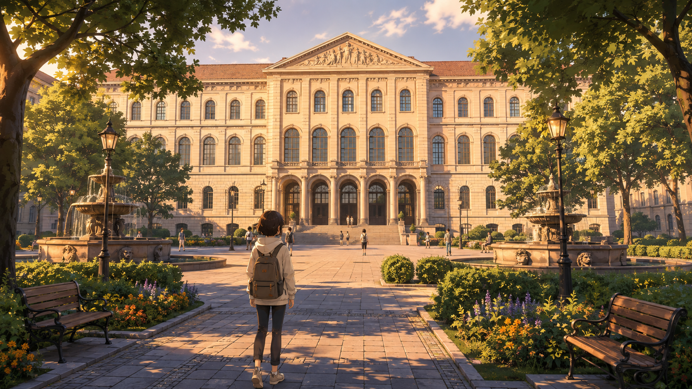

# LMU Munich Anime Sightseeing Game

A browser based third person sightseeing game prototype set around LMU Munich, with an anime inspired visual style.



## Run locally

From the repository root:

```bash
cd project
python3 -m http.server 8000
```

Open <http://localhost:8000/> in your browser.

## Controls

- **WASD**: move
- **Shift**: run
- **Mouse drag**: orbit the camera
- **Mouse wheel**: zoom
- **E**: inspect a nearby sightseeing point
- **P**: photography mode
- **Space**: save a screenshot

Three.js is loaded from the jsDelivr CDN.

## Static renders

Append `?render=facade`, `?render=plaza` or `?render=garden` to the local URL
for a composed still image. These modes hide the HUD, use a fixed scene time
and deterministic placement, and render only on initialization and resize.
They do not start the game loop or accept movement input.

To build three portable HTML previews without starting a server:

```bash
node scripts/build-static-previews.mjs /tmp/sim-munich-renders
```

Open `facade.html`, `plaza.html` or `garden.html` from that folder. Local scene
modules are embedded; an internet connection is still required for Three.js.
Static views use higher resolution shadows and supersampling with a four-million
pixel limit. The plaza and garden views show closer details of the scene.

In normal play, the animation loop stops when the page is hidden and resumes
when it becomes visible. Closing the page stops rendering.
